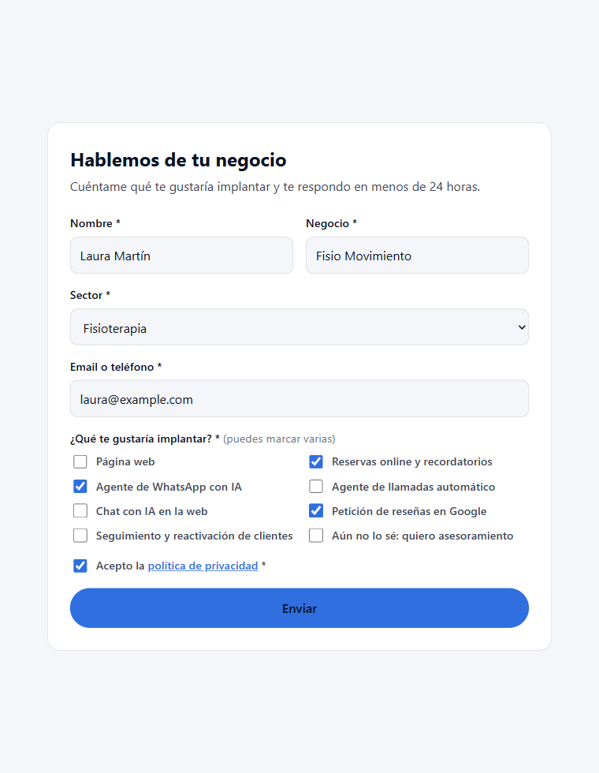
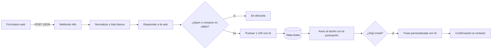
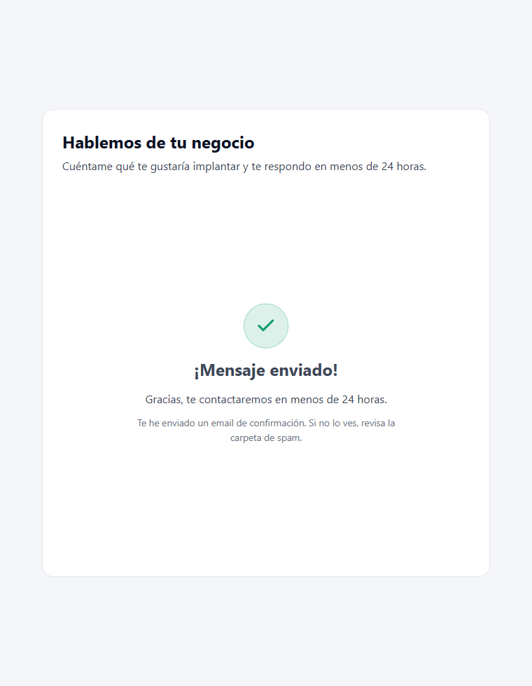
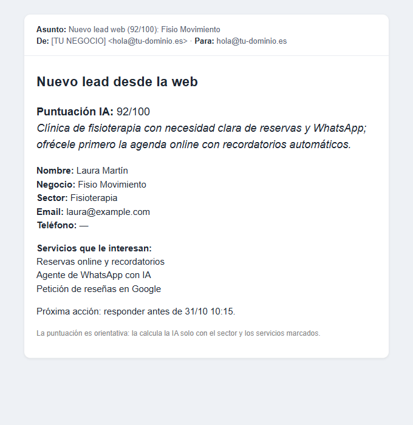
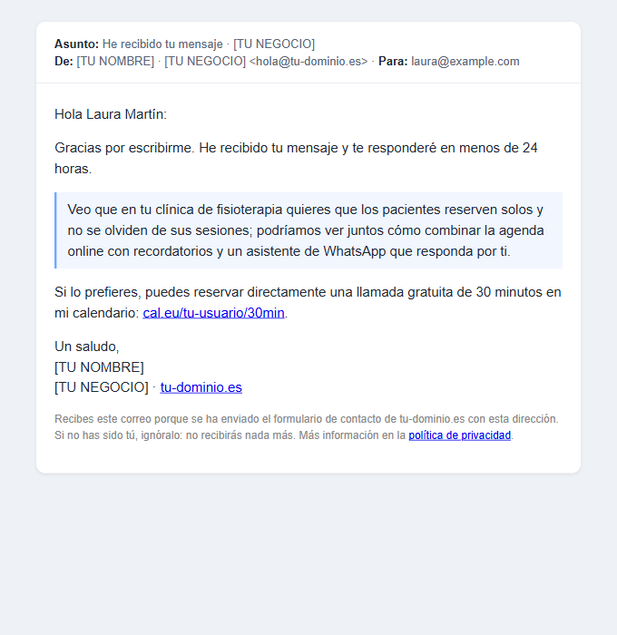

# Captación de leads con IA · n8n + Groq

Un formulario de contacto que no se queda en un email más: **limpia y filtra el spam, puntúa cada solicitud del 1 al 100 con IA, la guarda, avisa al dueño del negocio con la puntuación y responde al contacto con un email personalizado**, todo en segundos.

Está funcionando en producción en [aetherlabsai.tech](https://aetherlabsai.tech). Es el proyecto 0 del portafolio de [AetherLabsAI](https://aetherlabsai.tech): herramientas de IA a medida para clínicas, gimnasios y pequeños negocios.



## El problema

En un negocio pequeño, los contactos que llegan por la web se mezclan con el resto del correo. Nadie sabe cuáles merecen una llamada hoy y cuáles pueden esperar, el visitante no recibe ninguna señal de que alguien le ha leído y, si el formulario no tiene protección, se llena de spam.

## La solución

| Paso | Qué hace |
|---|---|
| 1. Formulario | El visitante elige su sector y **marca los servicios que le interesan** (en vez de un mensaje libre). Validación en el navegador y campo trampa antispam. |
| 2. Limpieza | n8n normaliza los datos, **acepta solo los valores exactos** del formulario (lista blanca) y descarta el spam y los contactos no válidos. |
| 3. Puntuación con IA | Un modelo de Groq valora la solicitud **del 1 al 100** (encaje del sector, valor del proyecto, claridad de la necesidad) y explica qué ofrecer primero. |
| 4. Registro | El lead queda en una tabla de n8n con su estado, la próxima acción y la puntuación. |
| 5. Aviso al dueño | Email con la **puntuación en el asunto**, el motivo y los datos de contacto. |
| 6. Confirmación | Si dejó email, recibe una confirmación con **una frase personalizada por IA** según su sector y servicios, y el enlace para reservar una llamada. |

Si la IA falla o tarda, **nada se rompe**: el lead se guarda con «sin evaluar» y la confirmación sale con la plantilla fija.

## Cómo funciona



La web recibe la respuesta en cuanto llegan los datos (paso «Responder a la web»); la IA y los emails trabajan después, así que el visitante no espera.

## Capturas

| Tras enviar | Aviso al dueño | Confirmación al contacto |
|---|---|---|
|  |  |  |

*Datos ficticios. Los emails de ejemplo están en [`docs/ejemplos/`](docs/ejemplos/).*

## Qué hay en el repositorio

```
workflows/captacion-leads.json   Workflow de n8n listo para importar
formulario/index.html            Formulario de ejemplo autónomo (HTML, CSS y JS sin dependencias)
docs/instalacion.md              Instalación paso a paso
docs/entrega.md                  Qué recibe el cliente al entregarlo
docs/privacidad.md               Privacidad desde el diseño
docs/ejemplos/                   Emails de ejemplo con datos ficticios
.env.example                     Valores que hay que configurar
```

## Instalación rápida

1. Necesitas **n8n** (autoalojado o en la nube) con Data Tables, una cuenta de correo **SMTP** y una clave de API de **[Groq](https://console.groq.com)**.
2. Crea en n8n la tabla `leads` con las columnas de [`docs/instalacion.md`](docs/instalacion.md#1-tabla-leads).
3. Crea las credenciales **SMTP** y **Groq** en n8n.
4. Importa `workflows/captacion-leads.json` (*Workflows → Import from file*), asigna las credenciales y la tabla, y personaliza los puntos marcados (dominios, emails, `[TU NOMBRE]`, `[TU NEGOCIO]`, enlace de reservas).
5. Activa el workflow y pon la URL de producción del webhook en `formulario/index.html` (`WEBHOOK_URL`).
6. Envía el formulario de prueba y revisa la ejecución en n8n.

Detalle completo en [`docs/instalacion.md`](docs/instalacion.md).

## Seguridad y privacidad

- **A la IA solo le llegan el sector y los servicios** (valores fijos del formulario) y si el contacto es email o teléfono. Nombre, negocio y datos de contacto no salen de n8n.
- **Lista blanca**: aunque alguien envíe peticiones a mano, solo pasan los textos exactos del formulario, así que no se pueden colar instrucciones a la IA.
- **La frase de la IA se revisa antes de enviarse**: se descarta si contiene enlaces, direcciones de correo, HTML, cifras, si no termina en punto o si es demasiado corta o larga. En ese caso va la plantilla fija.
- **El nombre se limpia** antes de entrar en el email, para que nadie pueda usar el formulario para mandar texto propio desde tu dominio.
- **CORS**: el webhook solo acepta peticiones desde los dominios configurados.
- Ninguna clave en el repositorio: todo va en las credenciales de n8n.

Más en [`docs/privacidad.md`](docs/privacidad.md).

## Costes

- **n8n**: gratis si lo alojas tú (un VPS pequeño basta) o según el plan de n8n Cloud.
- **Groq** (`openai/gpt-oss-120b`): cada lead hace dos llamadas, unos 800 tokens de entrada y 900 de salida en total. Con los precios publicados por Groq en octubre de 2026 (0,15 $ por millón de tokens de entrada y 0,60 $ por millón de salida) sale a **menos de una décima de céntimo por lead**.
- **Correo**: el SMTP de tu dominio.

## Licencia

[MIT](LICENSE) · Hecho por [Rodrigo Ordóñez · AetherLabsAI](https://aetherlabsai.tech). ¿Quieres algo así para tu negocio? [Hablemos](https://aetherlabsai.tech/#contacto).
